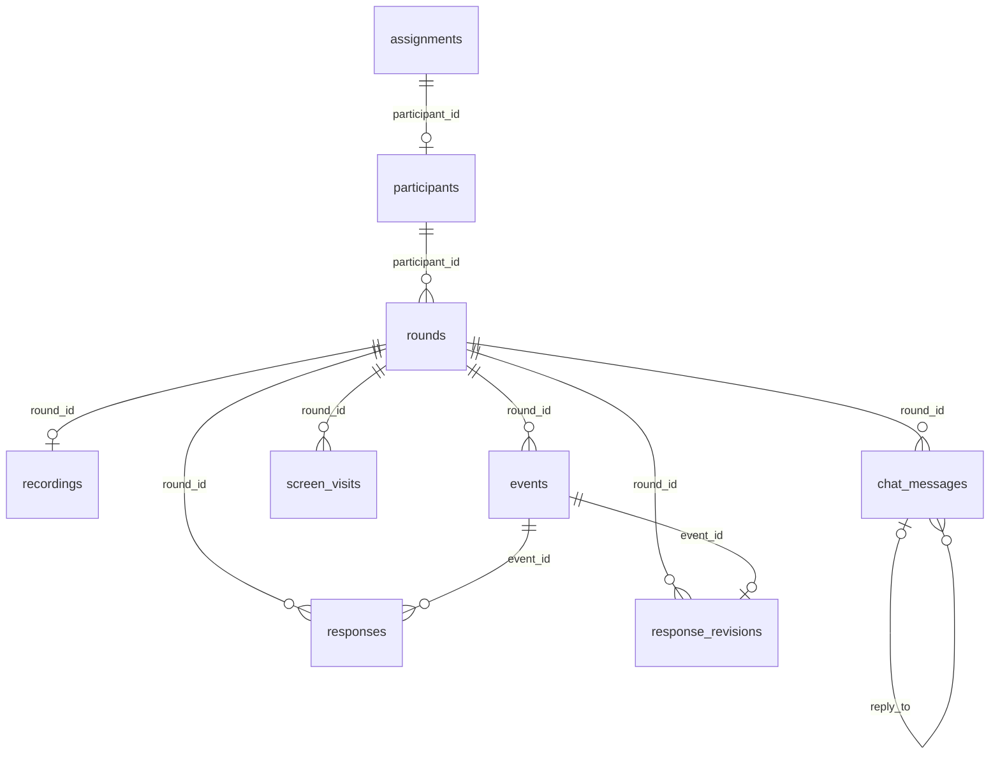

# Public speech experiment

참여자별 5회 발표를 녹화하고, 1–4회차에 피드백 해석과 행동계획을 작성하는 Next.js 실험 앱입니다. 5회차는 녹화와 분석 후 종료합니다. 영상 원본은 Firebase Storage에 저장하고, 파일 정보와 응답 및 과정 기록은 PostgreSQL의 `speech_experiment` 스키마에 저장합니다.

## 실행

```sh
npm install
npm run db:migrate
npm run db:assign -- db/assignments.csv
npm run dev:all
```

`dev:all`은 앱(http://localhost:3000), 옆 폴더의 `pub_speak_engine`(http://127.0.0.1:8000), 분석 워커를 함께 시작합니다. 엔진의 Python 환경에 `requirements.txt` 패키지가 설치되어 있어야 합니다. 필요하면 `SPEECH_ENGINE_PYTHON`으로 Python 실행 파일을 지정하세요.

개별 실행:

```sh
npm run dev
npm run worker
# ../pub_speak_engine에서
python -m uvicorn main:app --env-file .env --host 127.0.0.1 --port 8000
```

프로덕션은 `npm run build`, `npm run start`와 별도의 상시 분석 워커, 엔진 서비스가 필요합니다. 엔진 배포에는 `main.py`, `experiment.py`, `experiment_grouped.py`, `experiment_context.py`, `fdb_cat.json`, `speaking_materials.md`, `dockerfile`이 필요합니다. 원격 엔진을 사용하려면 수정된 엔진을 배포하고 서버의 `SPEECH_ENGINE_URL`을 변경하세요. HTTPS에서 카메라와 마이크를 사용할 수 있으며 localhost는 개발용 예외입니다.

## 참여자와 조건

`db/assignments.csv`는 `student01`부터 `student100`까지를 무작위로 사전 배정한 고정 명단입니다. ctrl 50명, exp 50명입니다. 재접속과 CSV 재가져오기로 조건이 무작위 변경되지 않습니다. 배정표에 없는 아이디는 입장할 수 없습니다. 최초 접속 시 참여자 기록과 1회차가 생성됩니다. 아이디 공백과 대소문자는 정규화합니다.

집단별 번호순 첫 두 아이디는 `is_test=true`입니다. 이들은 각 집단 50명에 포함되어 있으므로 실제 연구용은 집단별 48명입니다.

| 조건 | 테스트 아이디 |
| --- | --- |
| exp | student01, student02 |
| ctrl | student03, student06 |

실제 참여를 시작한 아이디의 조건은 배정표 가져오기로 변경할 수 없습니다. 아이디는 연구 식별자로 사용하며, 이 프로토콜은 아이디를 아는 사람이 해당 활동을 이어갈 수 있습니다. 세션은 서명된 HttpOnly 쿠키로 보호하고 API는 참여자와 조건을 확인합니다.

테스트 참여자의 데이터만 초기화:

```sh
npm run db:reset-test -- student01
```

이 명령은 해당 테스트 아이디의 녹화, 응답, 로그와 회차를 삭제하고 조건 배정은 유지합니다. 일반 연구 참여자의 초기화는 거절합니다.

## 활동 흐름

1. 사전 설문 링크를 확인한 뒤 입장합니다. 준비 화면에서 발표 지문을 읽고, 2회차부터는 직전 행동계획을 함께 확인합니다. 준비 경과 시간도 표시합니다.
2. `n번째 발표 시작`으로 웹캠과 마이크를 연결하고 녹화를 시작합니다. 우측 하단의 작은 미리보기, 분/초 타이머와 종료 버튼을 표시합니다.
3. 종료 후 녹화 영상을 확인하고 서버에 전송합니다. 브라우저는 WebM 또는 MP4를 사용합니다. 영상당 최대 100MB, 최대 2시간입니다. 용량 한계에 가까워지면 자동으로 녹화를 종료합니다.
4. 서버가 영상을 Firebase Storage에 저장하고 DB에 파일 정보와 경로를 기록합니다. 분석 작업자는 Storage에서 영상을 읽어 엔진으로 전달합니다. 약 2분 30초의 예상 분석 대기 중에는 같은 화면에서 본인 영상을 재생하고 탐색할 수 있습니다. 실제 분석 시간은 달라질 수 있습니다. 분석이 끝나도 영상 검토를 유지하고, 학습자가 `피드백 확인하기`를 눌렀을 때 이동합니다. 실패해도 저장된 영상으로 재분석할 수 있습니다. 분석 작업은 DB의 claim과 만료시간을 사용하므로 앱 재시작 후 워커가 이어서 처리할 수 있습니다.
5. 내용, 조직, 표현 및 전달에 피드백 하나씩 표시합니다. 고정 데모 영상이나 피드백을 사용하지 않습니다. 본인의 녹화 영상에서 근거 시각으로 이동할 수 있습니다.
6. 각 영역에서 비교, 설명, 비판적 판단을 작성합니다. 행동계획에서는 목표와 구체적인 실천 전략을 작성합니다.
7. `다음 발표 넘어가기`는 서버에 응답 저장이 완료된 뒤 동작합니다. 다음 준비 화면에 앞 회차의 계획과 발표 시작 버튼을 표시합니다.

5회차에서도 영상을 분석해 연구용 점수를 보존하지만 피드백 해석과 행동계획은 요구하지 않습니다.

## 엔진

서버 전용 Bearer 토큰으로 다음 엔드포인트를 호출합니다. 각 요청은 multipart `video`, 초 단위 `duration`, JSON 문자열 `study_context`를 받습니다. 앱 서버는 문맥을 직접 구성하므로 브라우저가 다른 참여자의 이전 피드백을 지정할 수 없습니다.

- `POST /experiment/feedback/ctrl`
- `POST /experiment/feedback/exp`
- `POST /experiment/analyze`: 마지막 회차 분석만 수행

루트 `fdb_cat.json`의 원문에는 세 대영역과 12개 세부영역이 있습니다. 이번 실험은 `topic_relevance`(주제 적절성), `presentation_materials`(발표 자료의 적절성)를 평가와 선정에서 제외하고 10개 세부영역을 사용합니다. 원문 파일과 기존 분석은 보존합니다. 루트 `speaking_materials.md`는 학습자가 읽는 공통 발표 자료입니다. `npm run rubric:sync`로 루브릭과 발표 자료를 엔진에 복사하며 `dev:all` 실행 시 자동 동기화합니다.

평가, 오류 항목 재요청, 최종 피드백과 exp 말투 조정 모두 `fdb_cat.json`의 원문 정의(`desc`)와 수준별 기술문(`levels`)을 유일한 평가 기준으로 사용하도록 지시합니다. 별도로 작성했던 세부영역 경계 문구는 사용하지 않습니다. 내부 `rationale`에는 실제 관찰이 선택한 기술문에 해당하는 이유를 기록하고, 해결책도 동일한 판단에서 도출합니다. 발표 자료와 이전 피드백은 참고 문맥이며 새로운 평가 기준이 되지 않습니다. 학습자에게 실제 평가 점수는 표시하지 않습니다. 루브릭 호버 도움말에는 네 단계별 원문 설명을 표시합니다. 로컬 프롬프트 버전은 `speech-study-2026-10-16-grouped-rubric-v6`입니다.

분석은 **대영역 3개 묶음 평가와 알고리즘 검증**을 사용합니다.

1. 내용, 조직, 표현 및 전달의 평가 요청 3개를 병렬로 실행합니다. 각 요청은 소속 세부영역별로 1–4점 정수와 관찰 근거, 문제 설명, 평가 이유, 해결책, 중립 피드백을 별도로 반환합니다. 합계 10개 세부영역을 평가하며 ctrl/exp 조건은 중립 평가에 전달하지 않습니다.
2. 생성 요청에 필수 필드, 항목 ID, 점수와 시각의 숫자 범위를 지정하는 JSON Schema를 적용합니다. Gemini 2.5는 호환되는 `responseMimeType`과 `responseJsonSchema` 설정을 사용합니다. 코드도 항목의 누락과 중복, 점수 범위, 필수 필드, 시각, 점수 노출과 금지 표현 등을 검사합니다. 명확한 시각 문자열이나 구간은 범위를 확인한 뒤 숫자 초로 변환하고 원래 표기를 보존합니다. 범위를 벗어난 숫자의 단위는 추정하지 않습니다. 오류 항목만 개별 재요청하며, 응답 전체의 JSON 구조가 잘못된 경우에는 해당 대영역을 한 번 재요청합니다. 계속 실패하면 저장된 영상으로 재분석할 수 있습니다.
3. 10개 항목이 모두 준비된 뒤 서버 코드가 대영역마다 가장 낮은 점수의 세부영역 하나를 선택합니다. 동점은 JSON에 있는 항목 순서로 결정합니다. 누락된 세부영역을 건너뛰거나 LLM이 다른 항목을 임의로 선택하도록 하지 않습니다.
4. ctrl은 선택된 중립 피드백을 그대로 사용합니다. exp는 선택된 세부영역의 현재 근거와 피드백을 받아 친절한 말투로 다듬습니다. 점수나 선정 항목은 바꾸지 않습니다. 최종 응답도 코드로 형식을 검사합니다. 별도의 AI 검토자는 호출하지 않습니다.
5. 앱 서버는 10개 평가의 완전성, 점수 범위, 최저점 선정, 표시할 항목 ID와 함께 반환된 문맥이 실제 전송한 문맥과 일치하는지 검사합니다.

코드 검증은 피드백의 의미가 다른 세부영역에 걸치는지, 관찰 내용이 실제 영상과 일치하는지를 인증하지 않습니다. `analysis.validation`에 검증 방식과 형식 오류 재요청 기록을 저장하고, `semanticScopeVerified`와 `videoEvidenceVerified`는 `false`로 기록합니다. 새 분석의 `scopeReports`는 빈 배열입니다.

발표 자료와 직전 피드백은 다음과 같이 활용합니다.

- 앱 서버가 `speaking_materials.md`의 원문과 SHA-256을 읽어 전송합니다. 엔진은 해당 루브릭의 정의와 기술문이 요구하는 판단에 관련된 경우에만 자료를 참고하도록 요청합니다. 자료에 적힌 내용을 실제 발화로 간주하거나, 보이지 않는 슬라이드가 있다고 추정하지 않도록 지시합니다.
- 같은 참여자의 바로 앞 회차에서 저장된 피드백을 조회합니다. 첫 회차이거나 이전 피드백이 없으면 `previousRound`는 `null`입니다. 이전 점수와 내부 평가 자료는 전달하지 않습니다.
- 대영역 평가에는 그 대영역의 이전 피드백만 전달합니다. 항목별 재요청과 말투 조정에는 같은 세부영역의 이전 피드백만 전달합니다. 이전 버전의 항목 ID를 현재 루브릭에 연결할 수 없으면 `null`로 표시하고 해당 대영역의 참고 문맥으로 제공합니다.
- 이전 문제가 이번 영상에서도 지속되는지, 달라졌는지, 판단하기 어려운지를 실제 현재 근거에 따라 피드백에 반영하도록 지시합니다. 이전 지적을 자동으로 반복하거나 개선을 가정하지 않으며, 현재 점수와 최저점 선정은 이번 수행을 기준으로 합니다.
- `rounds.analysis.context`에 회차 번호, 사용한 발표 자료 원문과 해시, 참조한 직전 회차 번호와 피드백을 보존합니다. 평가, 형식 오류 재요청, 실험 조건 말투 조정에 같은 문맥을 사용합니다. 직접 엔진을 호출할 때 문맥을 생략하면 엔진에 동기화된 발표 자료와 이전 피드백 없는 문맥을 사용합니다.

평가 점수와 전체 세부영역별 피드백은 서버 DB의 `analysis.criterionAssessments`, `analysis.scores`에 보관합니다. 선정 ID와 동점 규칙은 `selectedItemIds`, `selectionRule`로 저장합니다. 연구 데이터 내보내기에는 포함되지만 학습자 API는 공개 필드만 반환하므로 점수와 내부 검증 자료를 전달하지 않습니다. 챗봇에도 평가 점수를 제공하지 않으며 추정/공개를 금지합니다.

화면에는 대영역별 선택된 세부영역의 피드백 한 문단만 표시합니다. 호버 도움말은 해당 세부영역의 정의와 수준별 설명만 보여 주며, 실제 평가 점수와 숫자 수준 표시는 넣지 않습니다. 여러 세부영역의 루브릭을 한꺼번에 보여 주지 않습니다. 기존 저장 활동은 변경하지 않으며 새 분석부터 이 파이프라인을 적용합니다.

평가와 재요청은 기본 최대 4개씩 병렬로 실행합니다. 엔진 환경변수 `STUDY_ANALYSIS_WORKERS`를 1~6으로 설정해 동시 호출 수를 조정할 수 있습니다. 프롬프트 버전, 루브릭 파일 해시, 모델과 전체 루브릭 스냅샷을 분석 결과에 보존합니다. 기존 엔진의 일반 분석 루브릭과 경로는 유지합니다.

## 데이터

[`db/schema.sql`](db/schema.sql)이 스키마의 기준입니다. **모든 테이블은 `public`이 아닌 `speech_experiment` 스키마에 있습니다.** DB 관리 화면에서 스키마를 `speech_experiment`로 선택해야 테이블이 보입니다. SQL에서는 `speech_experiment.responses`처럼 스키마명을 함께 지정하세요.

테이블은 9개이고, 회차별 지표를 조회하는 `round_metrics` 뷰가 1개 있습니다. 테스트 계정도 같은 테이블에 저장하며, `assignments.is_test`로 구분합니다. 테스트 계정의 기록이 자동으로 삭제되지는 않습니다.

| 테이블 / 뷰 | 수집 내용 |
| --- | --- |
| assignments | 연구자가 정한 참여자별 조건 배정과 테스트 여부 |
| participants | 실제 접속한 참여자의 조건, 최초 접속과 최종 완료 시점 |
| rounds | 회차, 상태, 활동 시작, 영상 전송 시점, 완료 시점, 중단 시점, 마지막 확인, 분석 결과와 피드백 |
| recordings | 회차별 Firebase 버킷, 파일 경로와 generation, SHA-256, MIME, 녹화 길이, 용량, 저장 시점 |
| responses | 영역별 해석, 목표, 전략의 최신 응답(과거 priority는 보존) |
| response_revisions | 입력 변경마다 이전 글, 새 글, 필드, 클라이언트 시각, 서버 수신 시각 |
| events | 회차와 화면, 클릭 컴포넌트, 발생 시각, 수신 시각, 가시성, 중단, 상태 전환 |
| screen_visits | 화면 진입, 마지막 확인, 종료 사유, 체류 구간과 실제 보이는 동안의 시간 |
| chat_messages | 질문과 답변 전문, 영역, 단계, 시각, 질문-답변 연결, 실패 상태와 제공 맥락 |
| round_metrics | 회차 완료 여부, 해석/계획 체류 및 활성 시간, 챗봇 사용 여부, 첫 사용 시점, 총 이용 시간 |

### 테이블 관계



`assignments.participant_id`와 `participants.id`가 같은 연구 아이디입니다. 회차별 자료는 `round_id`로 `rounds.id`에 연결하고, 참여자별 조회는 `rounds.participant_id`를 통해 연결합니다. `responses.event_id`는 최신 응답을 만든 이벤트를, `response_revisions.event_id`는 각 수정 이벤트를 가리킵니다.

### 컬럼과 키

아래 컬럼명과 자료형은 실제 스키마를 기준으로 합니다. PK는 기본키, FK는 외래키입니다. 모든 시각 컬럼은 `timestamptz`이며, SQL 조회 예시에서는 한국 시각으로 표시합니다. `*_ms`와 `duration_ms`는 밀리초, 분석 JSON의 `seconds`는 초 단위입니다.

| 테이블 | 키와 제약 | 주요 컬럼 |
| --- | --- | --- |
| `assignments` | PK: `participant_id` (`text`) | `condition` (`text`, `control`/`experiment`), `is_test` (`boolean`), `created_at` |
| `participants` | PK: `id` (`text`, FK → `assignments.participant_id`) | `condition`, `created_at`, `last_seen_at`, `completed_at` |
| `rounds` | PK: `id` (`uuid`), FK: `participant_id` → `participants.id`; 참여자와 `number` 조합은 유일 | `number` (`smallint`, 1–5), `state`, `started_at`, `recording_ended_at`, `completed_at`, `interrupted_at`, `last_seen_at` |
| `recordings` | PK 겸 FK: `round_id` (`uuid`) → `rounds.id`; 회차당 최대 1개 | `mime_type`, `duration_ms` (`bigint`), `byte_size` (`bigint`), `storage_bucket`, `storage_path`, `storage_generation`, `sha256`, `video` (`bytea`, 이전 방식의 호환용 nullable 열), `recorded_at` |
| `events` | PK: `id` (`uuid`), FK: `round_id` → `rounds.id` | `type`, `screen`, `component`, `client_at`, `received_at`, `payload` (`jsonb`) |
| `responses` | 복합 PK: `round_id`, `stage`, `area`, `field`; FK: `round_id`, `event_id` | `value` (`text`, 최신 응답), `updated_at`, `event_id` (`uuid` → `events.id`) |
| `response_revisions` | PK 겸 FK: `event_id` (`uuid`) → `events.id`; FK: `round_id` → `rounds.id` | `stage`, `area`, `field`, `before_value`, `after_value`, `client_at`, `received_at` |
| `screen_visits` | PK: `id` (`uuid`, 방문 식별자), FK: `round_id` → `rounds.id` | `screen`, `started_at`, `last_seen_at`, `ended_at`, `end_reason`, `active_ms` (`bigint`) |
| `chat_messages` | PK: `id` (`uuid`), FK: `round_id` → `rounds.id`; `reply_to` → 같은 테이블의 `id` | `area`, `stage`, `role` (`user`/`assistant`), `content`, `client_at`, `received_at`, `reply_to`, `status`, `context` (`jsonb`) |

`rounds`에는 다음 분석 처리 컬럼도 있습니다.

| 컬럼 | 자료형 | 의미 |
| --- | --- | --- |
| `analysis_started_at` | `timestamptz` | 워커가 분석 작업을 가져간 시각 |
| `analysis_claim` | `uuid` | 현재 작업을 소유한 워커의 식별 토큰 |
| `analysis_attempts` | `integer` | 분석 시도 횟수 |
| `analysis_error` | `text` | 분석 실패 시 오류 기록 |
| `analysis` | `jsonb` | 세부영역별 점수, 피드백, 선정 결과, 모델과 루브릭 버전 등 연구용 분석 원본 |
| `feedback` | `jsonb` | 대영역별로 선정된 피드백 배열. 학습자 API는 공개 허용 필드만 반환 |

`rounds.analysis`의 새 분석 결과에는 `criterionAssessments`(현재 10개 세부영역 평가), `scores`(항목별 점수), `selectedItemIds`(대영역별 선정 항목), `selectionRule`(최저점과 동점 처리 규칙), `validation`(알고리즘 검증과 재요청 기록), `context`(발표 자료와 직전 피드백), `model`, `promptVersion`, `rubricVersion`, `rubricCategories`가 들어갑니다. `scopeReports`는 새 파이프라인에서 빈 배열입니다. 이전에 저장한 결과는 당시 분석 버전에 따라 JSON 구조가 다를 수 있습니다. 점수와 내부 평가 자료는 학습자 화면에 공개하지 않습니다.

### 단계와 응답 필드

CSV 배정표의 `ctrl`과 `exp`는 DB에서 각각 `control`과 `experiment`로 저장됩니다.

| 구분 | 값 | 의미 |
| --- | --- | --- |
| 회차 상태 `state` | `ready`, `recording`, `analyzing`, `analysis_failed`, `sense`, `plan`, `completed` | 발표 준비, 녹화, 분석 중, 분석 실패, 피드백 이해, 행동계획, 회차 완료 |
| 활동 단계 `stage` | `sense`, `plan` | 피드백 이해, 행동계획 |
| 평가 대영역 `area` | `content`, `organization`, `expression` | 내용, 조직, 표현 및 전달 |
| 이해 활동의 `field` | `comparison`, `explanation`, `judgment` | 비교, 설명, 비판적 판단 |
| 행동계획의 `field` | `goal`, `strategy` | 목표, 실천 전략. 과거 `priority` 데이터는 보존 |
| 채팅 `status` | `pending`, `completed`, `failed` | 답변 대기, 처리 완료, 처리 실패 |

강제 순위 입력은 제거했습니다. 예전에 수집한 `priority` 응답과 수정 로그는 보존하지만, 새 화면과 진행 조건에는 사용하지 않습니다. `events.type`에는 화면 진입/종료(`screen_enter`, `screen_leave`), 주기적 확인(`heartbeat`), 클릭(`click`), 응답 수정(`response_edit`), 중단(`interruption`), 화면 표시 상태(`visibility`), 챗봇 사용 구간(`chat_start`, `chat_end`), 녹화 오류(`recording_error`), 서버 단계 전환(`transition`)이 기록됩니다.

`responses`는 필드별 최신 값이고, `response_revisions`는 입력 과정의 수정 이력입니다. 챗봇 입력은 `chat_messages`에 저장되므로 활동 응답과 별개입니다. 입력 전에는 응답 테이블이 비어 있을 수 있습니다. `client_at`은 브라우저에서 발생한 시각, `received_at`은 서버에서 수신한 시각입니다.

### 회차별 집계 뷰

`speech_experiment.round_metrics`는 원본 테이블을 조회해서 계산하는 뷰이며, 별도의 집계 테이블에 저장하는 방식은 아닙니다. 회차당 한 행을 반환합니다.

| 컬럼 | 의미 |
| --- | --- |
| `id`, `participant_id`, `condition`, `is_test`, `number`, `state` | 회차와 참여자 식별, 조건, 테스트 여부, 진행 상태 |
| `started_at`, `recording_ended_at`, `completed_at`, `interrupted_at`, `last_seen_at` | 발표 시작, 녹화 전송 처리, 회차 완료, 중단, 마지막 확인 시각 |
| `completed` | `completed_at` 존재 여부 |
| `sense_active_ms`, `plan_active_ms` | 각 활동 화면의 활성 시간 합계 |
| `sense_residence_ms`, `plan_residence_ms` | 화면 진입부터 종료 또는 마지막 확인까지의 체류 시간 합계 |
| `chat_used` | 사용자 질문 메시지 존재 여부 |
| `chat_started_at` | 최초 `chat_start` 이벤트 시각 |
| `chat_active_ms` | `chat_end` 이벤트의 `durationMs` 합계 |

### 저장 여부 확인 SQL

다음 쿼리는 조회만 수행합니다. `student01`을 확인할 연구 아이디로 바꾸면 됩니다. 영상 조회는 용량이 큰 `video` 컬럼을 제외합니다.

```sql
SET TIME ZONE 'Asia/Seoul';

-- 테이블과 뷰 목록: public이 아닌 speech_experiment 스키마 조회
SELECT table_schema, table_name, table_type
FROM information_schema.tables
WHERE table_schema = 'speech_experiment'
ORDER BY table_name;

-- 참여자와 테스트 여부
SELECT p.*, a.is_test
FROM speech_experiment.participants p
JOIN speech_experiment.assignments a ON a.participant_id = p.id
WHERE p.id = 'student01';

-- 회차별 상태와 수집 지표
SELECT *
FROM speech_experiment.round_metrics
WHERE participant_id = 'student01'
ORDER BY number;

-- 최신 활동 응답
SELECT r.number, d.stage, d.area, d.field, d.value, d.updated_at
FROM speech_experiment.responses d
JOIN speech_experiment.rounds r ON r.id = d.round_id
WHERE r.participant_id = 'student01'
ORDER BY r.number, d.stage, d.area, d.field;

-- 응답 수정 이력
SELECT r.number, d.stage, d.area, d.field,
       d.before_value, d.after_value, d.client_at, d.received_at
FROM speech_experiment.response_revisions d
JOIN speech_experiment.rounds r ON r.id = d.round_id
WHERE r.participant_id = 'student01'
ORDER BY d.client_at, d.received_at;

-- 클릭을 포함한 활동 로그
SELECT r.number, e.type, e.screen, e.component, e.client_at, e.payload
FROM speech_experiment.events e
JOIN speech_experiment.rounds r ON r.id = e.round_id
WHERE r.participant_id = 'student01'
ORDER BY e.client_at;

-- 챗봇 질문과 답변
SELECT r.number, m.area, m.stage, m.role, m.content,
       m.client_at, m.received_at, m.reply_to, m.status
FROM speech_experiment.chat_messages m
JOIN speech_experiment.rounds r ON r.id = m.round_id
WHERE r.participant_id = 'student01'
ORDER BY m.received_at, m.client_at;

-- 영상 메타데이터: 영상 바이트는 가져오지 않음
SELECT r.number, v.mime_type, v.duration_ms, v.byte_size, v.recorded_at
FROM speech_experiment.recordings v
JOIN speech_experiment.rounds r ON r.id = v.round_id
WHERE r.participant_id = 'student01'
ORDER BY r.number;

-- 평가 점수와 대영역별 선정 항목: 연구자용 내부 자료
SELECT number, analysis -> 'scores' AS scores,
       analysis -> 'selectedItemIds' AS selected_items,
       analysis -> 'context' -> 'materials' ->> 'sha256' AS materials_sha256,
       analysis -> 'context' -> 'previousRound' AS previous_feedback
FROM speech_experiment.rounds
WHERE participant_id = 'student01'
ORDER BY number;
```

### 저장과 내보내기

수정과 클릭 이벤트는 UUID로 중복을 방지합니다. 실패한 전송은 참여자별 localStorage 큐에 보관하고 재시도합니다. 다음 단계 이동 전에 큐 저장을 확인합니다. 세션 간 데이터는 서버에서 복원합니다. ctrl은 챗봇 API와 챗봇 기록에 접근할 수 없습니다.

화면 활성 시간은 브라우저가 보이는 동안 계산하며 체류 시간과 별도로 제공합니다. 챗봇 시간은 패널의 포커스 또는 클릭/키 입력부터 다른 영역 클릭, 포커스 이탈, 숨김, 또는 60초 무입력까지의 구간입니다. 15초마다 구간을 기록합니다. 화면 종료와 중단은 pagehide 및 명시적 나가기로 기록합니다. 강제 종료나 전원 차단은 종료 이벤트를 보장할 수 없어 마지막 heartbeat 시각을 별도로 보존합니다. 이런 경우 실제 중단 시각은 추정 범위를 가진 값이며 마지막 확인 시각을 확정 종료 시각으로 바꾸지 않습니다.

영상 원본은 Firebase Storage에 저장합니다. DB에는 경로와 검증 정보를 보관하며, 전체 용량은 연구 운영자가 관리해야 합니다. 100명 × 5회 영상은 녹화 길이에 따라 수십 GB가 될 수 있습니다. 배포 환경의 요청 크기 제한도 함께 확인하세요.

데이터 내보내기는 기본적으로 테스트 참여자를 제외합니다. 영상 파일은 출력하지 않고 메타데이터만 포함합니다.

```sh
npm run db:export
npm run db:export -- exports/with-tests --include-tests
```

## 환경변수

앱 `.env.local` 또는 `.env`:

- `DATABASE_URL`: PostgreSQL URL
- `SESSION_SECRET`: 참여자 세션 서명
- `GEMINI_API_KEY`, `GEMINI_MODEL`: 실험집단 챗봇
- `SPEECH_ENGINE_URL`: 엔진 URL
- `SPEECH_ENGINE_TOKEN`: 서버 간 공유 토큰

엔진 `.env`에는 `GEMINI_API_KEY`와 동일한 `SPEECH_ENGINE_TOKEN`이 필요합니다. 새로운 실험 경로는 Firebase 로그인이나 GCS 권한을 요구하지 않습니다. 기존 Firebase 분석 경로는 그대로 유지됩니다. API 키와 DB URL은 브라우저로 전달하지 않습니다.

구현 참고: [Next.js Route Handlers](https://nextjs.org/docs/app/getting-started/route-handlers), [node-postgres 트랜잭션](https://node-postgres.com/features/transactions), [Gemini Files API](https://ai.google.dev/gemini-api/docs/files), [Gemini 생성 설정과 출력 스키마](https://ai.google.dev/api/generate-content#v1beta.GenerationConfig).

## 검증

```sh
npm run test:unit
npm run test:e2e
# 엔진 의존성이 설치된 Python으로
python -m unittest discover -s tests/engine -v
npm run build
```

Playwright는 실제 브라우저 MediaRecorder에 합성 영상/음성 스트림을 입력하고 실제 PostgreSQL 저장을 검증합니다. 분석 응답은 테스트 엔진을 사용해 AI 비용 없이 5회차 흐름을 확인합니다. 임시 QA 아이디만 생성하고 정리하며, 지정된 네 테스트 아이디나 실제 참여자를 변경하지 않습니다. 실제 카메라/마이크는 사용자의 브라우저와 장치에서 확인해야 합니다. Gemini 통합 검증은 별도로 실제 영상과 엔진을 호출해 수행합니다. 앱과 엔진을 실행한 상태에서 `npm run test:live -- /path/video.mp4 25`로 25초 영상의 업로드, 실제 분석, 피드백 표시, 챗봇 답변과 DB 기록을 확인할 수 있습니다. 이 검증은 실제 Gemini API를 호출하고 임시 QA 아이디를 정리합니다.

최근 검증: 프로덕션 빌드, Node 테스트 7개, 엔진 테스트 31개가 통과했습니다. 브라우저 6개 시나리오에서 5회 전체 절차와 DB 저장, 권한 거부와 데이터 접근 차단, 장치 점검, 완료/중단 영상 복구와 실제 재생, 기술적 재촬영, 질문 초안 복원, 질문 생성 잠금/실패 후 재시도/완료 답변 재사용, 분석 대기 중 최종 종료를 확인했습니다. 브라우저 반복 절차는 Chromium 가상 카메라/마이크와 고정 분석 응답을 사용합니다. 별도로 실제 4분 32초 영상의 exp 분석은 약 74초에 성공했고, 10개 평가와 제외 항목, 시각 계약, 이전 비교 기록을 확인했습니다. 실제 Gemini 챗봇도 질문/답변을 저장하고 같은 요청 재전송 시 각각 1개를 유지하는 것을 확인했습니다. 시간은 1회 실측이며 의미적 정확성이나 평균 지연을 보장하지 않습니다. 기존 참여자 기록은 삭제하거나 재분석하지 않았습니다.


## 2026-10-16 절차 및 로그 보완

- 행동계획은 영역별 목표와 실천 전략만 필수입니다. 다음 준비 화면에는 순위 없이 세 영역의 계획을 표시합니다.
- 발표 자료 원문을 준비 화면에 표시하며 2회차부터는 직전 행동계획을 함께 보여 줍니다. 준비 경과 시간과 5회 절차, 장치 점검 및 영상 전송 안내를 제공합니다.
- 루브릭 원문은 보존하고 새 평가와 선정만 10개 항목으로 제한합니다. 분석 JSON의 `excludedRubricIds`, `rubricCategories`, `promptVersion`으로 당시 평가 범위를 확인합니다. 제외 항목의 과거 피드백은 다음 분석 문맥에서 제외합니다.
- 내부 `previousComparison`은 같은 세부영역의 직전 피드백과 현재 관찰의 비교입니다. 이번 근거(`evidence`)와 평가 이유(`rationale`)는 현재 영상에 한정하고, 비교는 별도로 저장합니다. exp 말투 조정도 이 비교를 전달받습니다. 비교와 실제 영상 근거의 의미적 정확성을 알고리즘이 보증하는 것은 아닙니다.
- 새 피드백 `text`에는 장면 시각을 직접 쓰지 않습니다. `seconds`에서 버튼과 시각 표시를 생성하고, 본문의 시각 표기는 오류로 재요청합니다. 내부 evidence에는 실제 근거 시각을 기록할 수 있습니다. 이 검사는 잘못된 장면 선택 자체를 인증하지 않습니다.
- 녹화 전에 카메라 미리보기와 마이크 입력 막대를 확인할 수 있으며 점검 영상은 전송하지 않습니다. 업로드 전 영상은 IndexedDB에 청크별로 저장하고 같은 브라우저에서 새로고침 후 복구합니다. 저장 용량/권한 제한이 있으면 경고합니다. 브라우저 저장소 삭제나 마지막 미저장 청크까지의 복구는 보장하지 않습니다. 성공적으로 전송하면 IndexedDB의 복구용 임시 본을 삭제합니다. 현재 회차의 브라우저 메모리 원본은 영상 검토에 재사용하고 회차 종료/이동 또는 앱 종료 시 해제합니다.
- 기술적 재촬영은 사유를 선택한 뒤 진행합니다. `recording_attempts`와 `recording_started/stopped/retake/recovered/error` 이벤트에 시도와 사유를 남깁니다. 다시 시작하면 기존 로컬 영상은 교체되고 전송 후 재촬영은 제공하지 않습니다.
- 챗봇 초안은 회차/영역별 localStorage에 저장합니다. 질문 재시도는 같은 `requestId`를 사용하며, DB의 `request_id`와 `reply_to` 유일성 및 생성 잠금으로 중복을 방지합니다. 질문과 답변 수신 이벤트도 남깁니다.

### 시각 필드 정의

`npm run db:migrate`는 기존 자료를 삭제하지 않고 아래 열과 인덱스를 추가합니다.

| rounds 열 | 의미 |
|---|---|
| recording_started_at | 전송한 녹화 시도의 시작 시각(클라이언트) |
| recording_ended_at | 해당 시도의 실제 종료 시각(클라이언트), timing_version=2인 새 전송부터 적용 |
| upload_started_at | 영상 전송 시작 시각(클라이언트) |
| upload_received_at | 영상의 DB 저장 시각(서버) |
| analysis_started_at | 분석 작업을 가져간 시각(서버), 재시도 시 갱신 |
| analysis_completed_at | 분석 결과 저장 완료 시각(서버) |
| participant_finished_at | 5회차에서 참여자가 활동 마치기를 확인한 시각(서버) |
| completed_at | 1~4회차는 행동계획 종료, 새 5회차는 참여자의 활동 종료 확인 |
| recording_attempts | 발표 시작을 승인한 횟수, 장치 점검은 제외 |
| timing_version | 기존 1, 실제 녹화/전송 시각을 구분하는 새 자료는 2 |

기존 timing_version=1의 recording_ended_at/completed_at은 예전 의미를 유지합니다. 없는 시각을 추정해 채우지 않습니다. 클라이언트 시계와 서버 시계의 차이를 고려해서 분석해야 합니다. `interrupted_at`은 새로고침/나가기 등 일시 중단의 마지막 시각이며 연구 탈락 판정이 아닙니다. 전체 중단 이력은 events에 보존합니다.

5회차는 영상 전송 후 분석 완료를 기다리지 않고 활동을 마칠 수 있으며 분석은 계속됩니다. 따라서 참여 완료와 분석 성공은 별도로 확인해야 합니다. `round_metrics`에는 새 시각 필드와 촬영 시도 수, 챗봇 질문/답변 수가 포함됩니다.

### 활용 시간 정의

- `sense_active_ms`/`plan_active_ms`: 가시 상태 화면 체류 시간입니다. 집중/사고 시간을 직접 측정한 값이 아닙니다.
- `chat_active_ms`: 화면이 보이는 동안 챗봇의 초점/입력/포인터/스크롤 상호작용으로 시작하고, 다른 곳 이동이나 숨김 또는 60초 무상호작용 시 종료하는 추정 세션입니다. 응답 대기와 읽기를 포함할 수 있으며, 장시간 무조작 읽기를 모두 측정하지는 않습니다.
- `video_play/pause/seek/end/progress`: `source`, 현재 재생 위치와 알려진 영상 길이를 기록합니다. source는 before_upload/analysis_review/sense/plan입니다.
- `video_review_end`: 가시 상태 재생 구간의 durationMs입니다. 일시정지, 탐색, 숨김, 버퍼링과 화면 이동 시 구간을 나누며 주기적으로 저장합니다. 같은 구간을 다시 보면 다시 합산되므로 고유 영상 길이와 다릅니다.
- `rubric_open/close`: 호버/포커스/클릭으로 열린 기준의 항목 ID와 표시 시간을 기록합니다. 화면에 보였다는 사실이 이해도를 의미하지는 않습니다.
- response_revisions는 원시 입력 변경 로그입니다. 한글 조합 등으로 이벤트 수가 늘어날 수 있으므로 의미 있는 수정 횟수와 동일하게 해석하지 않습니다.


## 영상 재생 경로

현재 서버 재생은 Firebase Storage 범위 스트림을 사용합니다. 아래 DB substring 설명과 측정은 이전 DB 저장 영상의 호환 경로를 기술한 것이며, Firebase 이전 이후에는 파일 경로가 있는 영상부터 Storage를 사용합니다.

녹화 직후에는 `ExperimentRunner`가 Blob URL을 소유하고 분석 대기, 피드백 이해, 행동계획 화면에서 같은 원본을 재사용합니다. `Recorder`가 해제하는 업로드 전 미리보기 URL과는 별개의 URL입니다. 다음 회차로 이동하거나 마지막 활동을 마치면 해제하며, 업로드 성공 후 IndexedDB 복구 파일은 기존처럼 정리합니다. 업로드 자체와 분석 요청은 그대로 수행됩니다.

재접속/새로고침으로 메모리 원본이 없으면 `/api/recording/:roundId`를 사용합니다.

- 인증과 소유권을 확인한 뒤 영상 메타데이터를 조회합니다. 캐시 재검증과 HEAD에도 소유권 검사를 적용합니다.
- `Range: bytes=N-`은 우선 최대 1MB를 반환합니다. 이후 구간은 브라우저가 요청합니다. 범위가 지정된 요청과 suffix 요청은 지정 범위를 반환하고, 범위 없는 GET은 전체 길이의 200 응답을 스트리밍합니다.
- DB의 `substring(video ...)` 조회는 한 번에 최대 256KB입니다. 전체 영상을 먼저 버퍼링하지 않고 Web ReadableStream으로 순서대로 보내며, 요청 취소 시 후속 조회를 중단합니다. 취소 직전 이미 시작된 조회 한 건은 완료될 수 있습니다.
- `Content-Length`와 `Content-Range`는 실제 응답 구간을 표시합니다. HEAD는 영상 바이트를 읽지 않습니다. 잘못되거나 지원하지 않는 범위는 416을 반환합니다.
- `Cache-Control: private, no-cache`, `Vary: Cookie`, ETag를 사용합니다. 브라우저 캐시의 재사용 전에도 인증/소유권을 확인하며 다른 참여자에게 304를 반환하지 않습니다. 영상은 업로드 후 같은 roundId로 교체되지 않는 기존 정책을 유지합니다.

약 26MB 기존 영상의 로컬 1회 측정에서 서버 경로는 약 2.8초에 프레임을 준비하고 2.9초에 재생을 시작했습니다. 같은 파일을 브라우저 Blob URL로 재생한 별도 측정은 약 0.12초였습니다. 이전 전체 DB 조회 65.5초와 달리 전체 파일을 기다리지 않고 재생하는 것이 목적이며, 위 시간은 전체 다운로드 시간이나 평균 성능이 아닙니다. 측정과 검증 증거는 `exports/video-loading-2026-10-16/`에 저장합니다.

이번 영상 재생 변경의 검증은 단위 테스트 12개, 프로덕션 빌드, 관련 브라우저 시나리오 4개(5회 흐름, 녹화 복구, 원본 재사용/새로고침 전환, HTTP 범위/전체 응답/캐시/소유권)입니다. 실제 기존 영상의 Blob URL에서 94초로 이동한 측정은 약 0.15초였습니다. 기존 WebM을 재접속 후 서버 경로로 읽을 때는 먼 장면 탐색에 순차 범위 다운로드가 필요했고, 같은 94초 탐색이 30초 안에 끝나지 않았습니다. 이번 변경은 첫 재생 대기와 현재 회차 원본 재사용을 개선하며, 기존 영상의 원격 탐색까지 즉시 완료하도록 만드는 작업은 포함하지 않습니다.

## 운영 배포 (2026-10-16)

- 실험 앱: https://study.34.158.198.43.sslip.io
- 서버: SSH 별칭 `gcp-api`, `/home/teldexperiment/public_speech_experiment`
- 앱과 분석 작업자는 Docker 이미지 `public-speech-study:20261016-storage-materials`를 사용합니다. 컨테이너 이름은 `speech-study-app`, `speech-study-worker`입니다. 재시작 정책은 `unless-stopped`입니다.
- 앱은 `127.0.0.1:3000`에 연결하고 기존 Caddy가 HTTPS를 처리합니다. 영상 응답의 전달 지연을 줄이도록 해당 앱 프록시에 `flush_interval -1`을 적용합니다.
- 엔진은 `pub-speak-engine`이며, `speech-study` Docker 네트워크에서 앱/작업자가 `http://pub-speak-engine:8000`으로 호출합니다. 엔진의 기존 공개 주소와 다른 서비스의 Caddy 설정은 유지합니다.
- 비밀값은 이미지에 넣지 않습니다. 서버의 `runtime.env`를 권한 600으로 보관하고 `--env-file`로 전달합니다. `DATABASE_URL`, `SESSION_SECRET`, `GEMINI_API_KEY`, `SPEECH_ENGINE_TOKEN`, `SPEECH_ENGINE_URL` 및 `STUDY_APP_ORIGIN=https://study.34.158.198.43.sslip.io`가 필요합니다. 마지막 값은 프록시 내부 주소와 별도로 POST의 Origin을 검사하기 위한 공개 주소입니다. 로컬에서는 생략하면 요청 URL을 기준으로 검사합니다.
- `Dockerfile`은 Node 22에서 의존성 설치와 운영 빌드를 수행합니다. `.dockerignore`는 허용한 소스만 빌드 컨텍스트에 포함하며 `.env`, 영상, exports는 제외합니다.
- DB는 로컬과 같은 연구 DB를 사용합니다. 배포는 참여자 초기화 또는 배정표 재등록을 수행하지 않습니다.
- 엔진 파일 백업: `/home/teldexperiment/study-engine-before-v6-20261016`. Caddy 백업: 앱 배포 폴더의 `Caddyfile.before-20261016`. 차후 배포 시 새 이미지 태그를 사용하고 기존 이미지를 보관해야 합니다.

운영 검증에서 별도 QA 계정으로 HTTPS 로그인, 실제 약 4분 32초 영상 업로드, 최신 v6 엔진 분석, 세부영역 평가 10개와 대영역 피드백 3개 저장, 피드백 화면 표시, 영상 재생을 확인했습니다. 업로드부터 분석 결과 수신까지 1회 측정 약 95초였습니다. 영상의 1MB 범위 응답(206), 캐시 재검증(304), 비로그인 접근 차단(401), 외부 Origin 차단(403)도 확인했습니다. 단위 테스트 14개가 통과했습니다. 검증용 계정과 데이터는 제거했으며 student01의 기존 영상은 유지했습니다. 증거는 `exports/deploy-2026-10-16/verification.json`에 있습니다.

### 발표 시작과 녹화 시작 분리

`n번째 발표 시작`은 카메라 미리보기와 마이크 입력을 확인하는 준비 화면을 엽니다. 이 단계에서는 회차의 촬영 시작 시각과 촬영 시도 횟수를 기록하지 않으며, 녹화 파일이나 경과 시간도 생성하지 않습니다. `발표 녹화 시작`을 누르면 서버의 회차 시작 처리 후 실제 녹화와 타이머를 시작합니다. `점검 마치기`로 녹화하지 않고 준비 화면으로 돌아갈 수 있습니다.

운영 앱 이미지는 기존 배포 이미지를 기반으로 앱 소스를 교체하고 운영 빌드를 다시 수행했습니다. 분석 엔진과 작업자는 기존 버전을 유지합니다. 이전 앱 컨테이너는 `speech-study-app-before-record-button`으로 정지 보관하며 자동 재시작은 끕니다. 검증 증거는 `exports/record-button-2026-10-16/`에 저장합니다.

### AI 대화 스트리밍

AI 대화는 기존 Google GenAI SDK의 `generateContentStream`을 사용하며 모델과 대화 프롬프트는 유지합니다. 브라우저가 `Accept: application/x-ndjson`으로 요청하면 서버는 질문 예약 후 `start`, 생성된 텍스트의 `delta`, 저장 완료 후 `done` 이벤트를 보냅니다. `done` 전에도 텍스트가 말풍선에 표시됩니다. 응답은 `no-store, no-transform`과 `X-Accel-Buffering: no`를 사용하며 기존 Caddy 앱 경로의 `flush_interval -1`을 유지합니다. 스트리밍을 요청하지 않는 클라이언트와 저장된 답변의 재요청은 기존 JSON 응답을 지원합니다.

질문은 생성 전에 저장합니다. 답변과 질문의 완료 상태는 하나의 DB 트랜잭션으로 저장하고, 저장이 성공한 뒤에만 완료 이벤트를 보냅니다. 중간 실패는 부분 답변을 `status='failed'`로 저장하며 완성된 답변으로 사용하지 않습니다. 같은 requestId로 재시도하면 같은 질문과 답변 행을 재사용합니다. assistant 행의 `context.streamAttempts` 배열에는 각 시도의 content, status, startedAt, firstTokenAt, endedAt이 보존됩니다. firstTokenAt은 서버가 첫 텍스트를 전송한 시점이며 학습자의 실제 읽기 시각이 아닙니다. client_at은 마지막 시도의 종료 시각입니다. 답변 완료 수를 분석하려면 status='completed' 조건을 적용해야 하며 기존 chat_answer_count는 assistant 행 수입니다.

화면 이동이나 브라우저 연결 종료 후에도 서버는 제한된 생성 작업을 마치고 저장합니다. Next.js after로 후속 작업을 연결하고 생성에는 45초 제한을 적용합니다. 클라이언트는 70초까지 기다리며, 미완료 응답을 표시하고 질문 초안과 requestId를 보존합니다. 실패한 부분 답변은 이후 대화의 모델 입력에서 제외합니다. 다른 영역으로 이동하면 기존 화면의 요청 연결을 해제하고 늦은 응답으로 다른 영역의 대화를 덮어쓰지 않습니다.

검증: 단위 테스트 20개, 브라우저 테스트 3개, 운영 빌드 통과. 테스트는 완료 전 텍스트 표시, 한글과 이모지의 바이트 경계, 끊김과 부분 답변 저장, 연결 종료 후 저장, 재시도 및 중복 방지를 포함합니다. 실제 Gemini와 DB 연결 검증 자료는 `exports/chat-stream-2026-10-16/`에 저장합니다. 운영 앱 이전 컨테이너는 `speech-study-app-before-chat-stream`으로 정지 보관합니다.

## Firebase Storage 전환과 준비 화면

영상 버킷은 `speech-evaluator-1a56c.firebasestorage.app`입니다. 경로는 `experiments/student01/attempt_1/{roundId}.webm` 형식이며 attempt 번호는 1~5회 발표 회차입니다. 기술적 재촬영은 같은 회차에 속하고, 최종 전송한 파일을 보존합니다. 파일명에 회차 UUID를 사용하므로 테스트 계정을 초기화하고 재사용해도 이전 회차 파일을 덮어쓰지 않습니다. 제공된 Firebase 웹 apiKey로 영상을 공개 업로드하지 않습니다. 현재 참여자 세션과 회차 소유권을 확인한 서버가 공식 Google Cloud Storage 클라이언트를 사용해 해당 Firebase 버킷에 접근합니다.

### recordings 열

| 열 | 자료형 | 의미 |
|---|---|---|
| storage_bucket | text | Firebase 버킷 이름 |
| storage_path | text | experiments/참여자/attempt_회차/파일 경로 |
| storage_generation | text | 업로드된 객체의 정확한 generation |
| sha256 | text | 원본 바이트 SHA-256 |
| video | bytea, nullable | 이전 DB 저장 방식의 호환용 열. 새 업로드는 NULL |

새 업로드는 Firebase의 생성 전용 조건(ifGenerationMatch=0)으로 저장하고, 크기와 SHA-256 메타데이터를 검증한 후 회차와 DB 경로를 저장합니다. DB 저장만 실패한 재전송은 이미 존재하는 같은 객체를 확인해 재사용하고, 내용이 다른 파일은 덮어쓰지 않습니다. 고유 경로의 업로드가 성공한 뒤 DB 처리에 실패하면 객체가 남을 수 있으므로 해당 회차를 재시도해 연결해야 합니다. 업로드 전 브라우저 IndexedDB 복구와 녹화 직후 Blob URL 재사용은 유지합니다.

`/api/recording/:roundId`는 캐시 재검증과 HEAD를 포함해 매번 참여자 소유권을 확인합니다. 영상은 Firebase에서 HTTP 범위 스트림으로 읽으며 버킷의 공개 URL이나 영구 다운로드 토큰을 클라이언트에 발급하지 않습니다. 이전 DB 원본도 이전 스트리밍 경로로 읽을 수 있습니다. 분석 작업자 역시 Firebase 파일을 다운로드하고 길이와 SHA-256을 확인한 뒤 기존 엔진에 전달합니다. 내보내기는 원본 바이트를 포함하지 않고 버킷과 경로 등의 정보를 포함합니다. 테스트 계정 초기화는 해당 계정 DB 행에 연결된 Storage 파일도 삭제합니다.

서버는 GCP 서비스 계정의 Application Default Credentials를 사용합니다. 지정 버킷에 해당 계정의 `roles/storage.objectUser` 권한을 부여했습니다. 로컬은 ADC를 설정하거나, 이미 로그인된 gcloud 계정을 사용할 경우 `.env.local`에 `FIREBASE_STORAGE_USE_GCLOUD=true`를 설정할 수 있습니다. 후자는 개발 환경에서만 동작하며 gcloud의 단기 액세스 토큰을 메모리에서 갱신합니다. 비밀키를 이미지에 포함하지 않습니다. [Firebase의 공식 Storage 서버 안내](https://firebase.google.com/docs/storage/admin/start)를 참고하세요.

### 기존 원본 이전

```sh
node scripts/migrate-recordings.mjs
# Storage 다운로드의 원본 일치 검증 후 DB 복사본까지 정리할 때
node scripts/migrate-recordings.mjs --release-db-copy
```

마이그레이션은 실제 참여자와 지정된 테스트 계정(student 계정)을 대상으로 하고, 자동 QA 계정은 제외합니다. 각 파일을 Firebase에 저장한 뒤 다시 다운로드하여 크기와 SHA-256을 검증합니다. 기본 실행은 DB 바이트를 보존하고, release 옵션을 명시한 실행은 검증된 파일에 대해서만 DB 바이트를 NULL로 바꿉니다. 피드백, 응답, 이벤트와 시각은 변경하지 않습니다.

### 지문, 루브릭, 준비 시간과 설문

현재 지문은 `speaking_materials.md`의 **공공 서비스의 특성과 민간 위탁의 운영 방식**입니다. 준비 화면과 분석 요청은 같은 읽기 함수를 사용하여 원문과 SHA-256을 공유합니다. 엔진의 기본 지문도 같은 원문으로 동기화합니다. 기존 분석 결과의 지문 스냅샷은 유지하고, 새 분석에 현재 지문을 사용합니다.

준비 화면은 지문과 직전 회차 행동계획을 나란히 보여 줍니다. 준비 경과 시간은 준비 화면이 열려 있는 동안 누적하며 새로고침 시 같은 회차의 저장 시간을 복구합니다. 녹화와 분석 및 피드백 처리 시간은 더하지 않으며 다음 회차는 00:00부터 시작합니다. 브라우저 저장을 사용할 수 없으면 해당 화면 세션의 시계만 동작합니다. 연구용 가시 화면 체류 시간(screen_visits.active_ms)과 별도의 UI 시계입니다.

호버 루브릭의 단계명은 매우 잘함(내부 4), 잘함(3), 보통(2), 노력요함(1)이며 실제 화면에는 숫자를 표시하지 않습니다. 각 단계의 원래 기술문과 정의를 유지하고, 실제로 받은 등급을 표시하거나 강조하지 않습니다.

로그인 첫 화면은 [사전 설문](https://forms.gle/HADj4URaV4PweZig7)을 새 창으로 연결합니다. 전체 5회 활동을 마친 화면은 [사후 설문](https://forms.gle/BCAbMYZb9m4jxxzcA)을 연결합니다. 링크 방문만으로 설문 제출 여부를 판정하지 않습니다.

운영 검증에서 기존 영상 2개의 원본 SHA-256 일치를 확인하여 Firebase로 이전하고 DB 영상 바이트를 정리했습니다. DB 바이트 정리 후에도 기존 영상의 인증된 범위 재생을 확인했습니다. 별도 QA 계정의 실제 영상 업로드 → Firebase 저장 → 새 지문을 포함한 엔진 분석 → 피드백 표시 및 영상 재생도 통과했습니다. 루브릭 단계명, 준비 시계와 설문 링크를 확인했으며 단위 테스트 22개, 엔진 테스트 31개, 브라우저 시나리오 4개가 통과했습니다. 검증용 DB 행과 Storage 객체는 정리했습니다. 증거는 `exports/storage-materials-2026-10-16/verification.json`과 `migration.json`에 있습니다.
